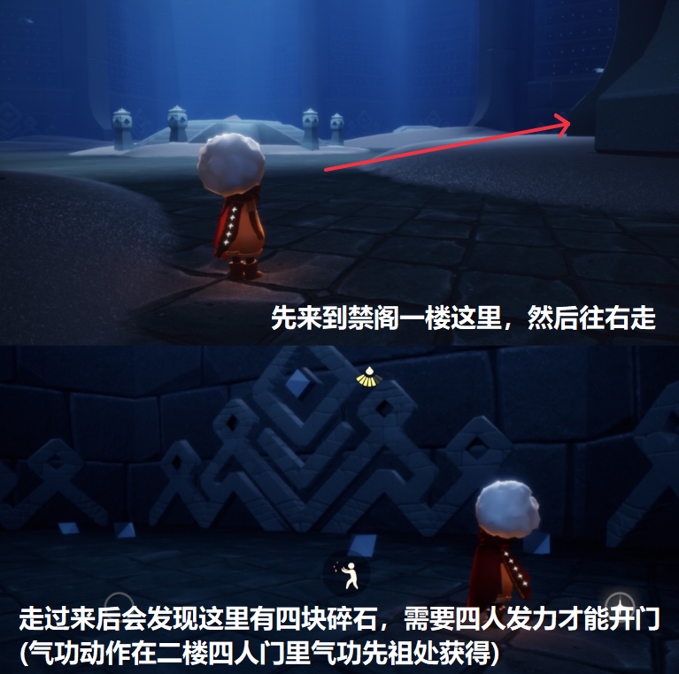
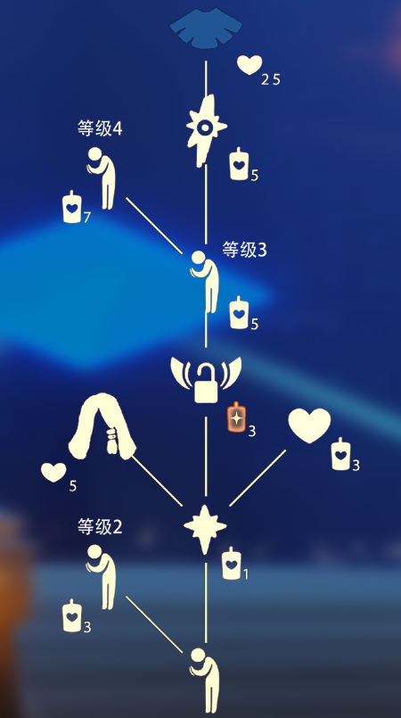

# 🌤 光遇每日任务

[](https://github.com/oivio-up/SkyDailyInfo/actions/workflows/update-daily.yml)

自动获取并展示《光·遇》每日任务和活动信息。

**[打开每日旅行手册 →](https://oivio-up.github.io/SkyDailyInfo/)** · 支持手机浏览、任务勾选、天气与图片攻略。

## 💡 项目说明

本项目通过 **Cloudflare Worker** 中转 API 请求，使用 **GitHub Actions** 每日自动更新，将光遇的每日任务和活动信息展示在 README 中。

### 特性

- ✨ 每日自动更新任务和活动信息
- 🔒 敏感数据（UID、Token）安全存储在 Cloudflare
- 🚀 通过 Cloudflare Worker 中转 API，保护隐私
- 📱 清晰的任务和活动展示
- 🖼️ 图片保存到仓库，避免外链代理失效
- ⏰ 北京时间每天 8:00 自动更新

---

<!-- DAILY_TASK_START -->
## 📅 2026年10月30日 每日任务

> 最后更新: 2026年10月30日 12:25:55 (北京时间)

### 🎯 今日旅行指南

```
【今日旅行指南】
1. 掀翻5只螃蟹
2. 在荧光小菇旁回复能量
3. 净化10株黑暗植物
4. 前往禁阁重温祈祷侍从的回忆
```

### 🌤️ 天气预报

天气播报：今日将会有灼热碎片坠落在圆梦村


### 📅 本月日历


### 📖 任务详细攻略


#### 📍 掀螃蟹攻略

【掀螃蟹】
在螃蟹周围长按角色，发出呐喊，即可掀翻周围的螃蟹哦。
走近被掀翻的螃蟹，会出现小图标，点击就可以抓起螃蟹啦~
 今日推荐：缀珠礼服20套染色穿搭参考https://ds.163.com/feed/6adf9b60446a4f1a707246c6/?utm_content=f_ma75.jl.jlctPT.top.jz9w5q&utm_term=wyds_dl_jl_sky3_5cb546a0d5456870b97d9424&utm_bothash=ma75_bot_367bc25a42d1935a6e04c90df3bd91be&q=掀螃蟹攻略


---


#### 📍 荧光小菇

【荧光小菇】
小贴士：旅人们跳到荧光小菇上可补充能量
(能量几乎消耗完时再跳上去会更容易完成每日任务哦)
地点：荧光小菇是生长在雨林的植物。
特性：荧光小菇呈半透明状态并且会发光，旅人们站在荧光蘑菇上可以悬浮起来，极容易辨认。
 今日推荐：雨林清净挂机点推荐https://ds.163.com/feed/69d3896180948732849861fb/?utm_content=f_ma75.jl.jlctPT.top.0lokyf&utm_term=wyds_dl_jl_sky3_5cb546a0d5456870b97d9424&utm_bothash=ma75_bot_367bc25a42d1935a6e04c90df3bd91be&q=荧光小菇


---


#### 📍 祈祷侍从

【禁阁·祈祷侍从】
先祖位置：禁阁一楼四人门里
如何进入：
1.需先获得禁阁二层先祖的动作(气功动作)　　　>>>气功动作第一层，在升降台的右侧和小伙伴合力打开四人门
3.先祖就在走廊的尽头安静等候~
兑换图鉴：
 今日推荐：珍珠季水手服穿搭推荐https://ds.163.com/feed/6adc445c41ead961916265bd/?utm_content=f_ma75.jl.jlctPT.top.vvmmbt&utm_term=wyds_dl_jl_sky3_5cb546a0d5456870b97d9424&utm_bothash=ma75_bot_367bc25a42d1935a6e04c90df3bd91be&q=祈祷侍从






---


#### 📍 季节蜡烛探索指南

https://h5.ds.163.com/v1/6ad585a083a764003172a423/?utm_content=f_ma75.jl.jlct.default.9v9w70&utm_bothash=ma75_bot_367bc25a42d1935a6e04c90df3bd91be


---


### 🎪 今日活动

今日暂无特殊活动

---

<!-- DAILY_TASK_END -->
