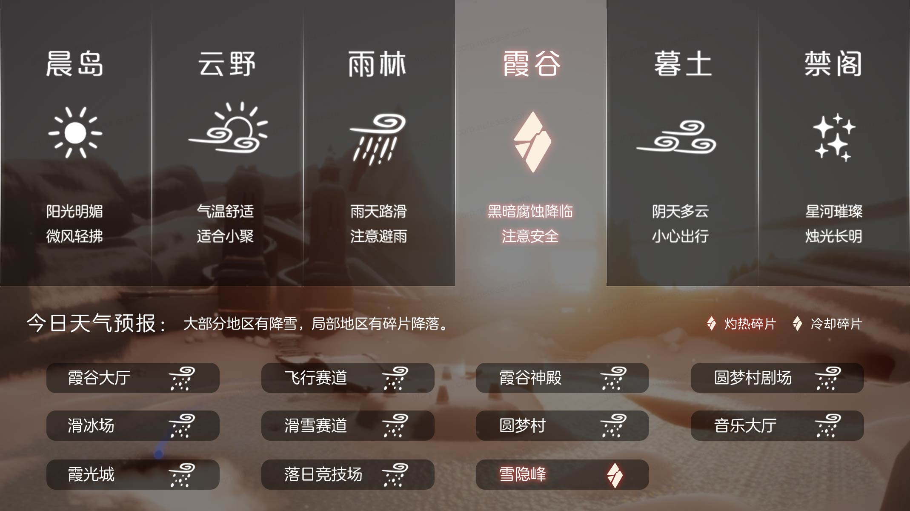
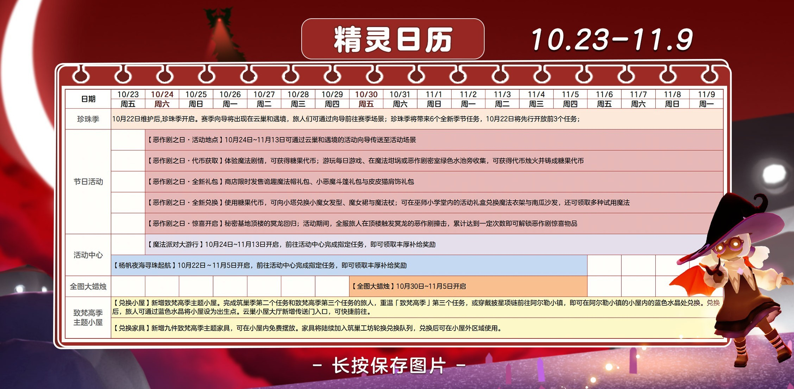
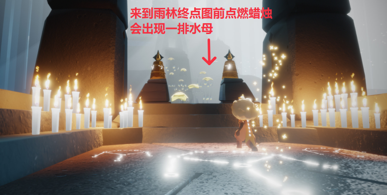

# 🌤 光遇每日任务

[](https://github.com/oivio-up/SkyDailyInfo/actions/workflows/update-daily.yml)

自动获取并展示《光·遇》每日任务和活动信息。

**[打开每日旅行手册 →](https://oivio-up.github.io/SkyDailyInfo/)** · 支持手机浏览、任务勾选、天气与图片攻略。

## 💡 项目说明

本项目通过 **Cloudflare Worker** 中转 API 请求，使用 **GitHub Actions** 每日自动更新，将光遇的每日任务和活动信息展示在 README 中。

### 特性

- ✨ 每日自动更新任务和活动信息
- 🔒 敏感数据（UID、Token）安全存储在 Cloudflare
- 🚀 通过 Cloudflare Worker 中转 API，保护隐私
- 📱 清晰的任务和活动展示
- 🖼️ 图片保存到仓库，避免外链代理失效
- ⏰ 北京时间每天 8:00 自动更新

---

<!-- DAILY_TASK_START -->
## 📅 2026年10月25日 每日任务

> 最后更新: 2026年10月25日 11:15:15 (北京时间)

### 🎯 今日旅行指南

```
【今日旅行指南】
1. 和朋友击掌
2. 在水母上回复能量
3. 向一位朋友招手
4. 帮助鸣谢收藏家
```

### 🌤️ 天气预报

天气播报：今日将会有灼热碎片坠落在雪隐峰




### 📅 本月日历




### 📖 任务详细攻略


#### 📍 每日任务·在水母上恢复能量

【每日任务－在水母上恢复能量】
位置：密林遗迹(水母图)
步骤：密林遗迹后往前飞，来到终点图前的雨亭，点亮蜡烛即可召唤出一排水母
注意：几乎消耗完能量后再跳上水母会更容易完成任务哦
 今日推荐：蝴蝶结宽沿帽穿搭推荐https://ds.163.com/feed/6a9d35e078de9d2c46d999e3/?utm_content=f_ma75.jl.jlctPT.top.bx7wtl&utm_term=wyds_dl_jl_sky3_5cb546a0d5456870b97d9424&utm_bothash=ma75_bot_367bc25a42d1935a6e04c90df3bd91be&q=每日任务·在水母上恢复能量





---


#### 📍 鸣谢收藏家任务

【每日任务－帮助鸣谢收藏家】
请旅人先查看接到的任务名称，然后在下方选择对应指南
在圣岛找到鸣谢收藏家　｜　鸣谢收藏家在云巢需要帮助
小精灵提示：
1、若旅人从未收集过该先祖，任务会显示为：在圣岛找到鸣谢收藏家；
2、若旅人之前已收集过该先祖，任务会显示为：鸣谢收藏家在云巢需要帮助。
 今日推荐：水果穿搭合集！https://ds.163.com/feed/6a05208388776b5fd2c24e59/?utm_content=f_ma75.jl.jlctPT.top.r8autn&utm_term=wyds_dl_jl_sky3_5cb546a0d5456870b97d9424&utm_bothash=ma75_bot_367bc25a42d1935a6e04c90df3bd91be&q=鸣谢收藏家任务


---


#### 📍 季节蜡烛探索指南

https://h5.ds.163.com/v1/6ad585a083a764003172a423/?utm_content=f_ma75.jl.jlct.default.9v9w70&utm_bothash=ma75_bot_367bc25a42d1935a6e04c90df3bd91be


---


### 🎪 今日活动

今日暂无特殊活动

---

<!-- DAILY_TASK_END -->
