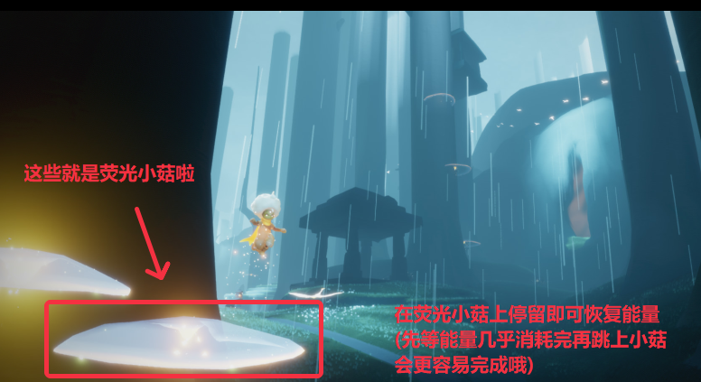
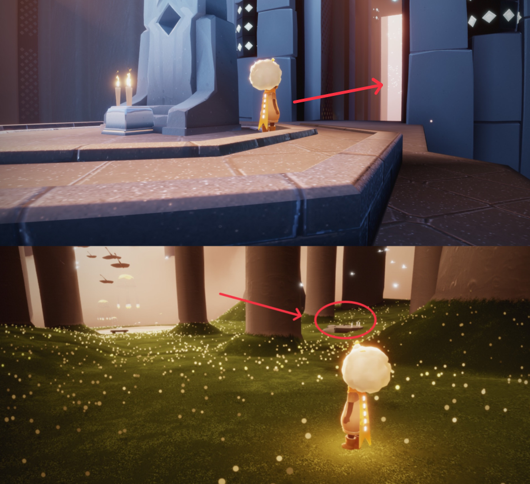

# 🌤 光遇每日任务

[](https://github.com/oivio-up/SkyDailyInfo/actions/workflows/update-daily.yml)

自动获取并展示《光·遇》每日任务和活动信息。

**[打开每日旅行手册 →](https://oivio-up.github.io/SkyDailyInfo/)** · 支持手机浏览、任务勾选、天气与图片攻略。

## 💡 项目说明

本项目通过 **Cloudflare Worker** 中转 API 请求，使用 **GitHub Actions** 每日自动更新，将光遇的每日任务和活动信息展示在 README 中。

### 特性

- ✨ 每日自动更新任务和活动信息
- 🔒 敏感数据（UID、Token）安全存储在 Cloudflare
- 🚀 通过 Cloudflare Worker 中转 API，保护隐私
- 📱 清晰的任务和活动展示
- 🖼️ 图片保存到仓库，避免外链代理失效
- ⏰ 北京时间每天 8:00 自动更新

---

<!-- DAILY_TASK_START -->
## 📅 2026年11月26日 每日任务

> 最后更新: 2026年11月26日 14:54:14 (北京时间)

### 🎯 今日旅行指南

```
【今日旅行指南】
1. 点燃20根蜡烛
2. 在荧光小菇旁回复能量
3. 收集30点烛火
4. 在雨林神殿的栖光雨坛旁冥想
```

### 🌤️ 天气预报

天气播报：今日无碎片降落


### 📅 本月日历


### 📖 任务详细攻略


#### 📍 荧光小菇

【荧光小菇】
小贴士：旅人们跳到荧光小菇上可补充能量
(能量几乎消耗完时再跳上去会更容易完成每日任务哦)
地点：荧光小菇是生长在雨林的植物。
特性：荧光小菇呈半透明状态并且会发光，旅人们站在荧光蘑菇上可以悬浮起来，极容易辨认。
 今日推荐：缀珠礼服20套染色穿搭参考https://ds.163.com/feed/6adf9b60446a4f1a707246c6/?utm_content=f_ma75.jl.jlctPT.top.jz9w5q&utm_term=wyds_dl_jl_sky3_5cb546a0d5456870b97d9424&utm_bothash=ma75_bot_367bc25a42d1935a6e04c90df3bd91be&q=荧光小菇




---


#### 📍 每日任务－在雨林的神庙内冥想

【每日任务－在雨林的神庙内冥想】
任务：在雨林的神庙内冥想
位置：在雨林－终点图树后方
步骤：进入雨林的终点图后，往前走一点点，在右方的树后面
视频指引：https://ok.166.net/gameyw-gbox/bot/205/20260807/410e964288fbbe080f632e3f905af0922b15e866.mp4
 今日推荐：一定要来打卡这个云朵音符！https://ds.163.com/feed/6af78ebd83b8293d558feee6/?utm_content=f_ma75.jl.jlctPT.top.6l9m1w&utm_term=wyds_dl_jl_sky3_5cb546a0d5456870b97d9424&utm_bothash=ma75_bot_367bc25a42d1935a6e04c90df3bd91be&q=每日任务－在雨林的神庙内冥想




---


#### 📍 季节蜡烛探索指南

https://h5.ds.163.com/v1/6ad585a083a764003172a423/?utm_content=f_ma75.jl.jlct.default.9v9w70&utm_bothash=ma75_bot_367bc25a42d1935a6e04c90df3bd91be


---


### 🎪 今日活动

今日暂无特殊活动

---

<!-- DAILY_TASK_END -->
