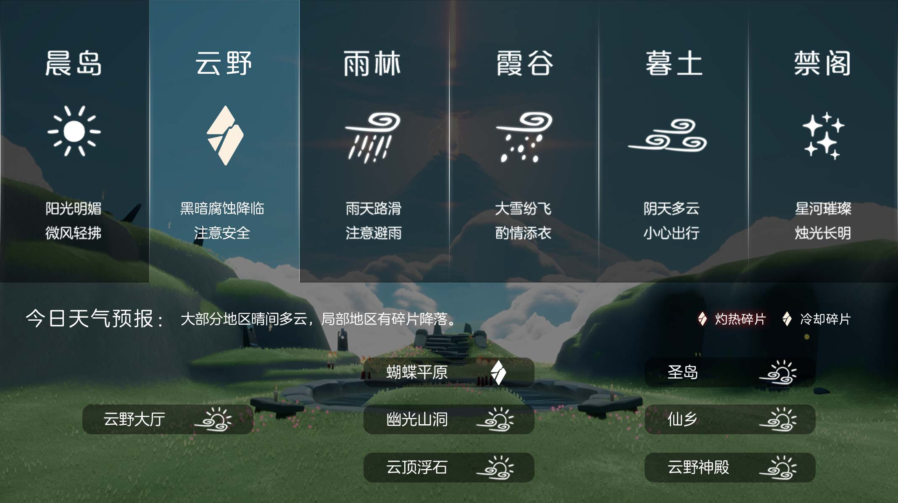

# 🌤 光遇每日任务

[](https://github.com/oivio-up/SkyDailyInfo/actions/workflows/update-daily.yml)

自动获取并展示《光·遇》每日任务和活动信息。

**[打开每日旅行手册 →](https://oivio-up.github.io/SkyDailyInfo/)** · 支持手机浏览、任务勾选、天气与图片攻略。

## 💡 项目说明

本项目通过 **Cloudflare Worker** 中转 API 请求，使用 **GitHub Actions** 每日自动更新，将光遇的每日任务和活动信息展示在 README 中。

### 特性

- ✨ 每日自动更新任务和活动信息
- 🔒 敏感数据（UID、Token）安全存储在 Cloudflare
- 🚀 通过 Cloudflare Worker 中转 API，保护隐私
- 📱 清晰的任务和活动展示
- 🖼️ 图片保存到仓库，避免外链代理失效
- ⏰ 北京时间每天 8:00 自动更新

---

<!-- DAILY_TASK_START -->
## 📅 2026年11月03日 每日任务

> 最后更新: 2026年11月03日 13:24:18 (北京时间)

### 🎯 今日旅行指南

```
【今日旅行指南】
1. 面对冥龙
2. 向一位玩家鞠躬
3. 向一位玩家招手
4. 帮助苦修行者
```

### 🌤️ 天气预报

天气播报：大部分地区地区阴天多云，蝴蝶平原将会有冷却碎片降落




### 📅 本月日历


### 📖 任务详细攻略


#### 📍 每日任务－面对冥龙

【每日任务－面对冥龙】
如何完成：被冥龙的探照灯照到一下即可完成
推荐地点：暮土二图，旅途中第一次遇到冥龙的地方
推荐地点视频指引：https://ok.166.net/gameyw-gbox/bot/205/20260805/170a3e18d68c63592816ab01d6174f2f57fbff94.mp4
今日推荐：缀珠礼服20套染色穿搭参考https://ds.163.com/feed/6adf9b60446a4f1a707246c6/?utm_content=f_ma75.jl.jlctPT.top.jz9w5q&utm_term=wyds_dl_jl_sky3_5cb546a0d5456870b97d9424&utm_bothash=ma75_bot_367bc25a42d1935a6e04c90df3bd91be&q=每日任务－面对冥龙


---


#### 📍 苦修行者任务

【每日任务－帮助苦修行者】
请旅人先查看接到的任务名称，然后在下方选择对应指南
在云峰找到苦修行者　｜　苦修行者在云巢需要帮助
小精灵提示：
1、若旅人从未收集过该先祖，任务会显示为：在云峰找到苦修行者；
2、若旅人之前已收集过该先祖，任务会显示为：苦修行者在云巢需要帮助。
 今日推荐：恶作剧之日魔女裙穿搭分享https://ds.163.com/feed/6adfbbc6ca8643644ab76386/?utm_content=f_ma75.jl.jlctPT.top.c9wnqq&utm_term=wyds_dl_jl_sky3_5cb546a0d5456870b97d9424&utm_bothash=ma75_bot_367bc25a42d1935a6e04c90df3bd91be&q=苦修行者任务


---


#### 📍 季节蜡烛探索指南

https://h5.ds.163.com/v1/6ad585a083a764003172a423/?utm_content=f_ma75.jl.jlct.default.9v9w70&utm_bothash=ma75_bot_367bc25a42d1935a6e04c90df3bd91be


---


### 🎪 今日活动

今日暂无特殊活动

---

<!-- DAILY_TASK_END -->
