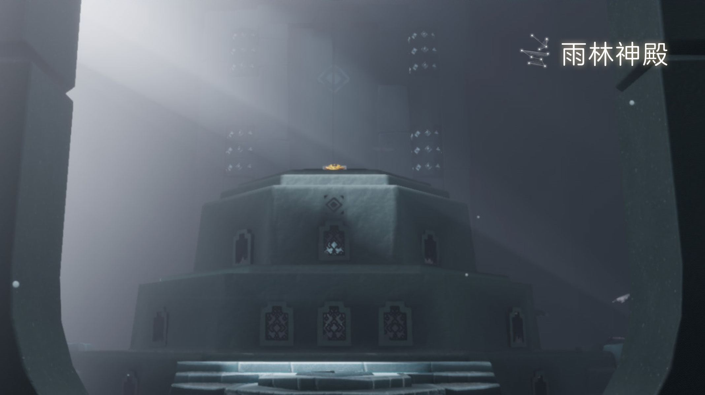
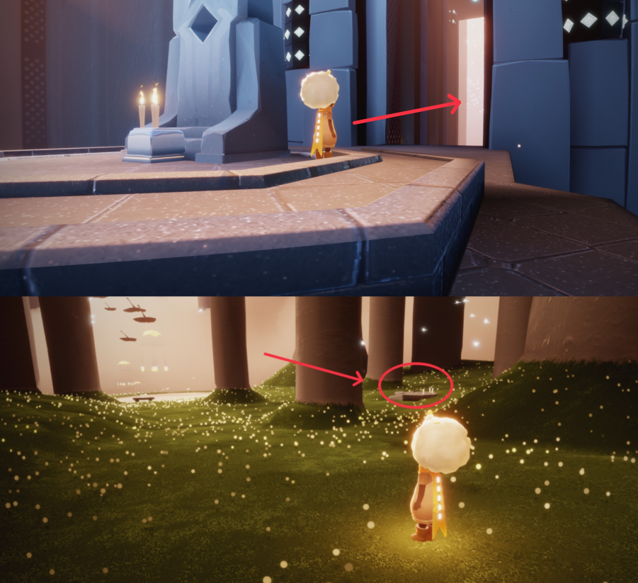

# 🌤 光遇每日任务

[](https://github.com/oivio-up/SkyDailyInfo/actions/workflows/update-daily.yml)

自动获取并展示《光·遇》每日任务和活动信息。

**[打开每日旅行手册 →](https://oivio-up.github.io/SkyDailyInfo/)** · 支持手机浏览、任务勾选、天气与图片攻略。

## 💡 项目说明

本项目通过 **Cloudflare Worker** 中转 API 请求，使用 **GitHub Actions** 每日自动更新，将光遇的每日任务和活动信息展示在 README 中。

### 特性

- ✨ 每日自动更新任务和活动信息
- 🔒 敏感数据（UID、Token）安全存储在 Cloudflare
- 🚀 通过 Cloudflare Worker 中转 API，保护隐私
- 📱 清晰的任务和活动展示
- 🖼️ 图片保存到仓库，避免外链代理失效
- ⏰ 北京时间每天 8:00 自动更新

---

<!-- DAILY_TASK_START -->
## 📅 2026年10月22日 每日任务

> 最后更新: 2026年10月22日 11:20:29 (北京时间)

### 🎯 今日旅行指南

```
【今日旅行指南】
1. 在雨林神殿的栖光雨潭旁冥想
2. 点亮一位玩家
3. 在水母上回复能量
4. 帮助天才建筑师
```

### 📅 本月日历


### 📖 任务详细攻略


#### 📍 每日任务－在雨林的神庙内冥想

【每日任务－在雨林的神庙内冥想】
任务：在雨林的神庙内冥想
位置：在雨林－终点图树后方
步骤：进入雨林的终点图后，往前走一点点，在右方的树后面
视频指引：https://ok.166.net/gameyw-gbox/bot/205/20260807/410e964288fbbe080f632e3f905af0922b15e866.mp4
今日推荐：被小黑夸好看的一套穿搭https://ds.163.com/feed/6a8687baa7bb2e4de4aeb7a0/?utm_content=f_ma75.jl.jlctPT.top.bzefp4&utm_term=wyds_dl_jl_sky3_5cb546a0d5456870b97d9424&utm_bothash=ma75_bot_367bc25a42d1935a6e04c90df3bd91be&q=每日任务－在雨林的神庙内冥想





---


#### 📍 每日任务·在水母上恢复能量

【每日任务－在水母上恢复能量】
位置：密林遗迹(水母图)
步骤：密林遗迹后往前飞，来到终点图前的雨亭，点亮蜡烛即可召唤出一排水母
注意：几乎消耗完能量后再跳上水母会更容易完成任务哦
 今日推荐：蝴蝶结宽沿帽穿搭推荐https://ds.163.com/feed/6a9d35e078de9d2c46d999e3/?utm_content=f_ma75.jl.jlctPT.top.bx7wtl&utm_term=wyds_dl_jl_sky3_5cb546a0d5456870b97d9424&utm_bothash=ma75_bot_367bc25a42d1935a6e04c90df3bd91be&q=每日任务·在水母上恢复能量


---


#### 📍 每日任务-帮助天才建筑师

【每日任务－帮助天才建筑师】
请旅人先查看接到的任务名称，然后在下方选择对应指南
在风行网道找到天才建筑师　｜　天才建筑师在风行网道需要帮助
小精灵提示：
1、若旅人从未收集过该先祖，任务会显示为：在风行网道找到天才建筑师；
2、若旅人之前已收集过该先祖，任务会显示为：天才建筑师在风行网道需要帮助
 今日推荐：被小黑夸好看的一套穿搭https://ds.163.com/feed/6a8687baa7bb2e4de4aeb7a0/?utm_content=f_ma75.jl.jlctPT.top.bzefp4&utm_term=wyds_dl_jl_sky3_5cb546a0d5456870b97d9424&utm_bothash=ma75_bot_367bc25a42d1935a6e04c90df3bd91be&q=每日任务-帮助天才建筑师


---


#### 📍 季节蜡烛探索指南

https://h5.ds.163.com/v1/6ad585a083a764003172a423/?utm_content=f_ma75.jl.jlct.default.9v9w70&utm_bothash=ma75_bot_367bc25a42d1935a6e04c90df3bd91be


---


### 🎪 今日活动

今日暂无特殊活动

---

<!-- DAILY_TASK_END -->
