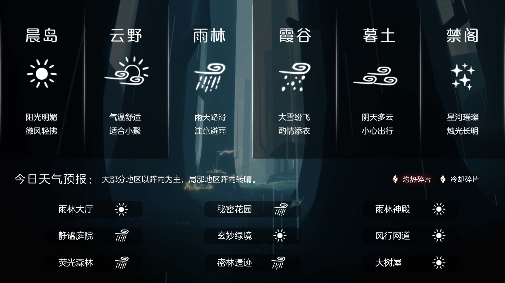
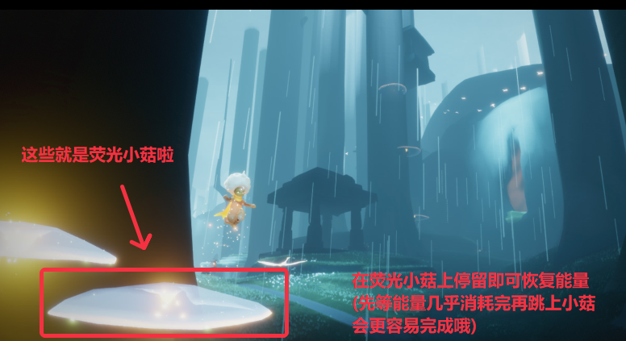
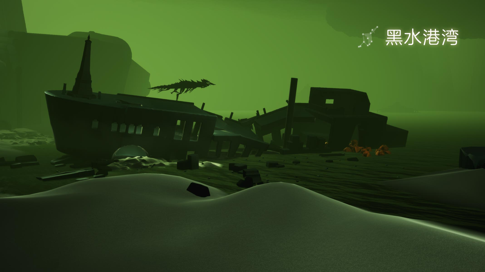
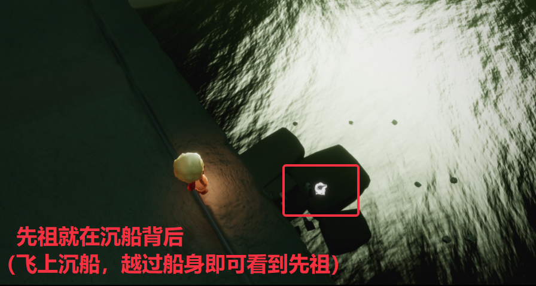
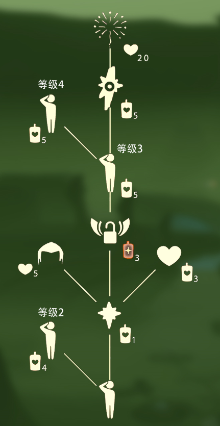

# 🌤 光遇每日任务

[](https://github.com/oivio-up/SkyDailyInfo/actions/workflows/update-daily.yml)

自动获取并展示《光·遇》每日任务和活动信息。

**[打开每日旅行手册 →](https://oivio-up.github.io/SkyDailyInfo/)** · 支持手机浏览、任务勾选、天气与图片攻略。

## 💡 项目说明

本项目通过 **Cloudflare Worker** 中转 API 请求，使用 **GitHub Actions** 每日自动更新，将光遇的每日任务和活动信息展示在 README 中。

### 特性

- ✨ 每日自动更新任务和活动信息
- 🔒 敏感数据（UID、Token）安全存储在 Cloudflare
- 🚀 通过 Cloudflare Worker 中转 API，保护隐私
- 📱 清晰的任务和活动展示
- 🖼️ 图片保存到仓库，避免外链代理失效
- ⏰ 北京时间每天 8:00 自动更新

---

<!-- DAILY_TASK_START -->
## 📅 2026年10月19日 每日任务

> 最后更新: 2026年10月19日 11:18:39 (北京时间)

### 🎯 今日旅行指南

```
【今日旅行指南】
1. 向一位玩家鞠躬
2. 接受一位朋友的礼物
3. 在荧光小菇旁回复能量
4. 前往暮土重温行礼船长的回忆
```

### 🌤️ 天气预报

天气播报：今日无碎片降落




### 📅 本月日历


### 📖 任务详细攻略


#### 📍 荧光小菇

【荧光小菇】
小贴士：旅人们跳到荧光小菇上可补充能量
(能量几乎消耗完时再跳上去会更容易完成每日任务哦)
地点：荧光小菇是生长在雨林的植物。
特性：荧光小菇呈半透明状态并且会发光，旅人们站在荧光蘑菇上可以悬浮起来，极容易辨认。
 今日推荐： 光崽干饭图鉴！九种类型你属于哪种？https://ds.163.com/feed/69e6189fd0179a4476925567/?utm_term=wyds_dl_jl_sky3_5cb546a0d5456870b97d9424&utm_content=f_ma75.jl.jlctPT.default.pzzzyt&utm_bothash=ma75_bot_367bc25a42d1935a6e04c90df3bd91be&q=荧光小菇




---


#### 📍 暮土-行礼船长

【暮土·行礼船长】
先祖位置：解锁一个暮土先祖后，进入黑水港湾(沉船图)里，飞到沉船的残骸后面，即可看到先祖
视频攻略：
https://ok.166.net/gameyw-gbox/bot/205/20260511/8736af761b3e2a81e9552aaebfd895acfc1e0135.mp4
兑换图鉴：
今日推荐：在暮土随机模仿小黑穿搭https://ds.163.com/feed/69a547218daa490c5d56a31e/?utm_content=f_ma75.jl.jlctPT.top.iko3m0&utm_term=wyds_dl_jl_sky3_5cb546a0d5456870b97d9424&utm_bothash=ma75_bot_367bc25a42d1935a6e04c90df3bd91be&q=暮土-行礼船长







---


### 🎪 今日活动

今日暂无特殊活动

---

<!-- DAILY_TASK_END -->
