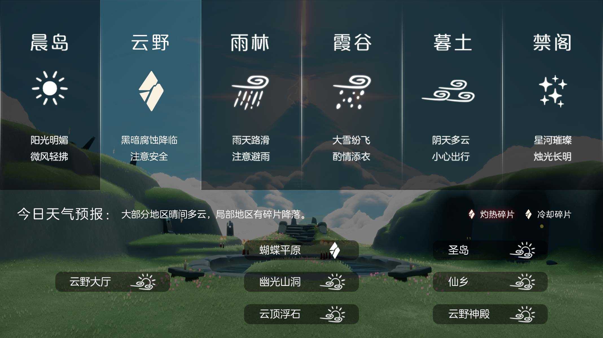
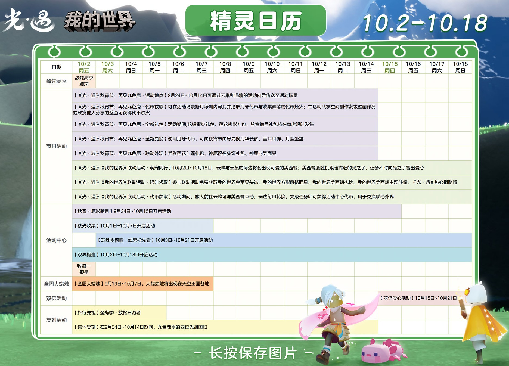

# 🌤 光遇每日任务

[](https://github.com/oivio-up/SkyDailyInfo/actions/workflows/update-daily.yml)

自动获取并展示《光·遇》每日任务和活动信息。

**[打开每日旅行手册 →](https://oivio-up.github.io/SkyDailyInfo/)** · 支持手机浏览、任务勾选、天气与图片攻略。

## 💡 项目说明

本项目通过 **Cloudflare Worker** 中转 API 请求，使用 **GitHub Actions** 每日自动更新，将光遇的每日任务和活动信息展示在 README 中。

### 特性

- ✨ 每日自动更新任务和活动信息
- 🔒 敏感数据（UID、Token）安全存储在 Cloudflare
- 🚀 通过 Cloudflare Worker 中转 API，保护隐私
- 📱 清晰的任务和活动展示
- 🖼️ 图片保存到仓库，避免外链代理失效
- ⏰ 北京时间每天 8:00 自动更新

---

<!-- DAILY_TASK_START -->
## 📅 2026年10月13日 每日任务

> 最后更新: 2026年10月13日 20:09:12 (北京时间)

### 🎯 今日旅行指南

```
【今日旅行指南】
1. 收集蓝色光芒
2. 向一位朋友招手
3. 接受一位朋友的礼物
4. 帮助谦虚舞者
```

### 🌤️ 天气预报

天气播报：大部分地区地区阴天多云，蝴蝶平原将会有冷却碎片降落




### 📅 本月日历




### 📖 任务详细攻略


#### 📍 每日任务－蓝色光芒

【蓝色光芒】
出现时机：
1、当日的每日任务有“收集蓝色光芒”时
2、接取了魔法季任务二时
3、森灵日活动期间，当旅人任务解锁至“收集蓝色光芒 储备净水”时
所在地图：霞谷溜冰场
位置指引：进入溜冰场就可以看到蓝色光芒啦，但要注意它有时候会潜入水底哦
 今日推荐：蝴蝶结宽沿帽穿搭推荐https://ds.163.com/feed/6a9d35e078de9d2c46d999e3/?utm_content=f_ma75.jl.jlctPT.top.bx7wtl&utm_term=wyds_dl_jl_sky3_5cb546a0d5456870b97d9424&utm_bothash=ma75_bot_367bc25a42d1935a6e04c90df3bd91be&q=每日任务－蓝色光芒


---


#### 📍 每日任务－帮助谦虚舞者

【每日任务－帮助谦虚舞者】
请旅人先查看接到的任务名称，然后在下方选择对应指南
在圆梦村剧场找到谦虚舞者　｜　谦虚舞者在圆梦村需要帮助
小精灵提示：
1、若旅人从未收集过该先祖，任务会显示为：在圆梦村剧场找到谦虚舞者；
2、若旅人之前已收集过该先祖，任务会显示为：谦虚舞者在圆梦村需要帮助


---


### 🎪 今日活动

今日暂无特殊活动

---

<!-- DAILY_TASK_END -->
