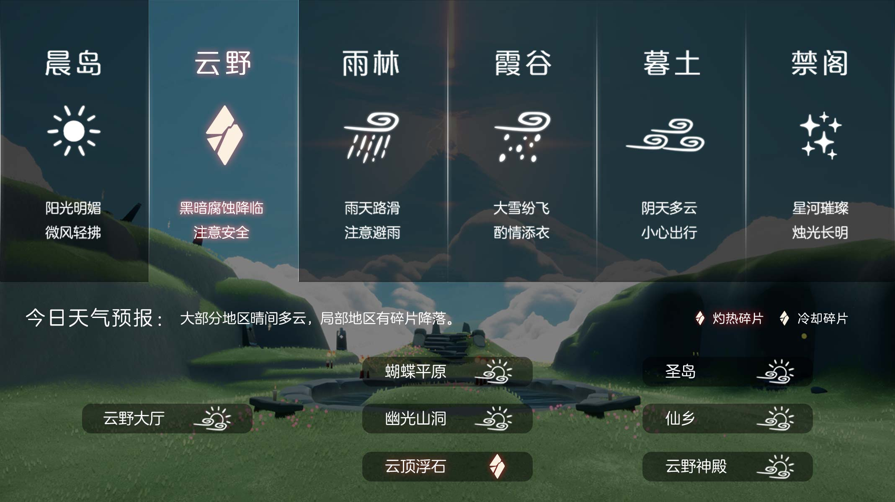
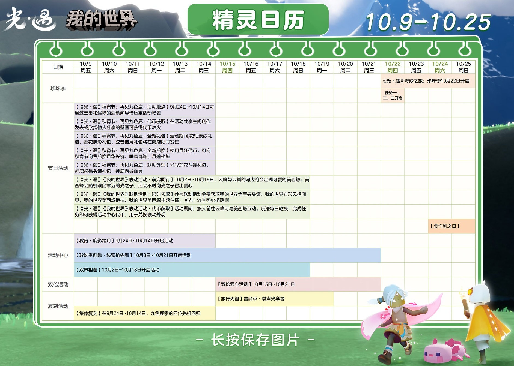
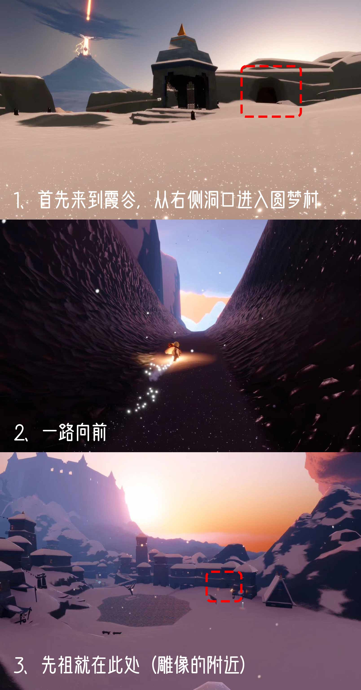

# 🌤 光遇每日任务

[](https://github.com/oivio-up/SkyDailyInfo/actions/workflows/update-daily.yml)

自动获取并展示《光·遇》每日任务和活动信息。

**[打开每日旅行手册 →](https://oivio-up.github.io/SkyDailyInfo/)** · 支持手机浏览、任务勾选、天气与图片攻略。

## 💡 项目说明

本项目通过 **Cloudflare Worker** 中转 API 请求，使用 **GitHub Actions** 每日自动更新，将光遇的每日任务和活动信息展示在 README 中。

### 特性

- ✨ 每日自动更新任务和活动信息
- 🔒 敏感数据（UID、Token）安全存储在 Cloudflare
- 🚀 通过 Cloudflare Worker 中转 API，保护隐私
- 📱 清晰的任务和活动展示
- 🖼️ 图片保存到仓库，避免外链代理失效
- ⏰ 北京时间每天 8:00 自动更新

---

<!-- DAILY_TASK_START -->
## 📅 2026年10月23日 每日任务

> 最后更新: 2026年10月23日 11:25:42 (北京时间)

### 🎯 今日旅行指南

```
【今日旅行指南】
1. 在雪隐峰捕捉浮动的光点
2. 向一位朋友招手
3. 掀翻5只螃蟹
4. 前往霞谷重温回旋大师的回忆
```

### 🌤️ 天气预报

天气播报：今日将会有灼热碎片坠落在云顶浮石




### 📅 本月日历




### 📖 任务详细攻略


#### 📍 每日任务-在雪隐峰捕捉浮动的光点

【在雪隐峰捕捉浮动的光点】
1.进入霞谷后，往右走，前往圆梦村
2.来到圆梦村后，往前走找到飞船站点
3.点亮飞船站点的机关，召唤飞船
4.乘坐飞船一路往上走即可来到雪隐峰
5.到达雪隐峰后向前走，能看到浮动的光点，触碰后可捕捉光点
小精灵提醒您：
1、进入圆梦村需要收集一位暮土常驻先祖　　　　　>>>点击查看
2、需要收集三个光点
3、在收集过程中若光点消失，旅人可尝试重新进入地图
图片指引：
视频指引：https://ok.166.net/gameyw-gbox/bot/205/20260807/020bae4fb35971d6064cb7d53b9d11263a505c9f.mp4
 今日推荐：《想你时风起》琴谱分享https://ds.163.com/feed/69ca579a348f8f5d0b7821ca/?utm_content=f_ma75.jl.jlctPT.top.8gq3ek&utm_term=wyds_dl_jl_sky3_5cb546a0d5456870b97d9424&utm_bothash=ma75_bot_367bc25a42d1935a6e04c90df3bd91be&q=每日任务-在雪隐峰捕捉浮动的光点


---


#### 📍 掀螃蟹攻略

【掀螃蟹】
在螃蟹周围长按角色，发出呐喊，即可掀翻周围的螃蟹哦。
走近被掀翻的螃蟹，会出现小图标，点击就可以抓起螃蟹啦~
 今日推荐：梵高季小鞋子搭配推荐https://ds.163.com/feed/6a818b34ed602c039ee8c8c7/?utm_content=f_ma75.jl.jlctPT.top.lj344c&utm_term=wyds_dl_jl_sky3_5cb546a0d5456870b97d9424&utm_bothash=ma75_bot_367bc25a42d1935a6e04c90df3bd91be&q=掀螃蟹攻略


---


#### 📍 梦想季回旋大师路线

【梦想季－回旋大师】
先祖位置：霞谷·圆梦村
小精灵提醒旅人：进入圆梦村需要收集一位暮土常驻先祖　　>>点击查看：暮土常驻先祖位置
视频指引：https://ok.166.net/gameyw-gbox/bot/205/20260803/5f3d827d12cad206c5d91ab787317a384e12e287.mp4
 今日推荐：《I Say Yeah》琴谱分享https://ds.163.com/feed/6a81c8d023fee73ea7424b76/?utm_content=f_ma75.jl.jlctPT.top.lqs9ot&utm_term=wyds_dl_jl_sky3_5cb546a0d5456870b97d9424&utm_bothash=ma75_bot_367bc25a42d1935a6e04c90df3bd91be&q=梦想季回旋大师路线




---


#### 📍 季节蜡烛探索指南

https://h5.ds.163.com/v1/6ad585a083a764003172a423/?utm_content=f_ma75.jl.jlct.default.9v9w70&utm_bothash=ma75_bot_367bc25a42d1935a6e04c90df3bd91be


---


### 🎪 今日活动

今日暂无特殊活动

---

<!-- DAILY_TASK_END -->
