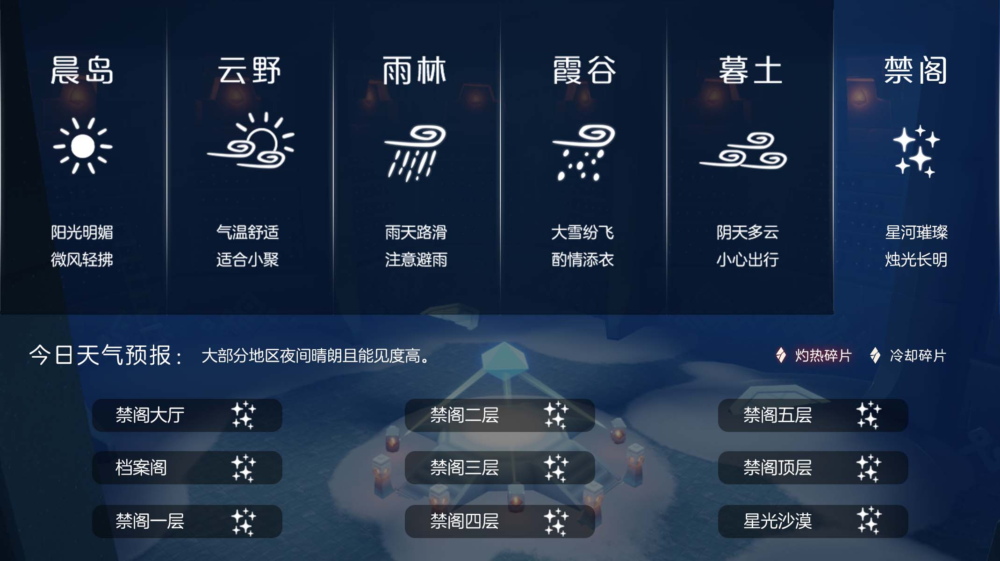

# 🌤 光遇每日任务

[](https://github.com/oivio-up/SkyDailyInfo/actions/workflows/update-daily.yml)

自动获取并展示《光·遇》每日任务和活动信息。

**[打开每日旅行手册 →](https://oivio-up.github.io/SkyDailyInfo/)** · 支持手机浏览、任务勾选、天气与图片攻略。

## 💡 项目说明

本项目通过 **Cloudflare Worker** 中转 API 请求，使用 **GitHub Actions** 每日自动更新，将光遇的每日任务和活动信息展示在 README 中。

### 特性

- ✨ 每日自动更新任务和活动信息
- 🔒 敏感数据（UID、Token）安全存储在 Cloudflare
- 🚀 通过 Cloudflare Worker 中转 API，保护隐私
- 📱 清晰的任务和活动展示
- 🖼️ 图片保存到仓库，避免外链代理失效
- ⏰ 北京时间每天 8:00 自动更新

---

<!-- DAILY_TASK_START -->
## 📅 2026年10月17日 每日任务

> 最后更新: 2026年10月17日 11:02:06 (北京时间)

### 🎯 今日旅行指南

```
【今日旅行指南】
1. 在密林遗迹冥想
2. 向一位玩家招手
3. 向一位玩家鞠躬
4. 帮助火花家长
```

### 🌤️ 天气预报

天气播报：今日无碎片降落




### 📅 本月日历


### 📖 任务详细攻略


#### 📍 每日任务－在密林遗迹冥想

【每日任务－在密林遗迹冥想】
任务：在密林遗迹冥想
位置：在雨林－密林遗迹(雨林水母图)
步骤：进入雨林后来到水母图(雨林第三幅地图)，往右前方的树洞走，穿越树洞后，飞向左前方的小亭子就能看到
视频指引：
https://ok.166.net/gameyw-gbox/bot/205/20260924/112a95542a4a21046d2292e540b771b0499b172c.mp4
 今日推荐：雨林清净挂机点推荐https://ds.163.com/feed/69d3896180948732849861fb/?utm_content=f_ma75.jl.jlctPT.top.0lokyf&utm_term=wyds_dl_jl_sky3_5cb546a0d5456870b97d9424&utm_bothash=ma75_bot_367bc25a42d1935a6e04c90df3bd91be&q=每日任务－在密林遗迹冥想


---


#### 📍 火花家长任务

【每日任务－帮助火花家长】
请旅人先查看接到的任务名称，然后在下方选择对应指南
在霞谷神殿找到火花家长　｜　火花家长在云巢需要帮助
小精灵提示：
1、若旅人从未收集过该先祖，任务会显示为：在霞谷神殿找到火花家长；
2、若旅人之前已收集过该先祖，任务会显示为：火花家长在云巢需要帮助。
今日推荐：夏之日头发这样穿就可以得到！https://ds.163.com/feed/6a7061c050c8bb3e2fce806b/?utm_content=f_ma75.jl.jlctPT.default.eescrx&utm_term=wyds_dl_jl_sky3_5cb546a0d5456870b97d9424&utm_bothash=ma75_bot_367bc25a42d1935a6e04c90df3bd91be&q=火花家长任务


---


### 🎪 今日活动

今日暂无特殊活动

---

<!-- DAILY_TASK_END -->
