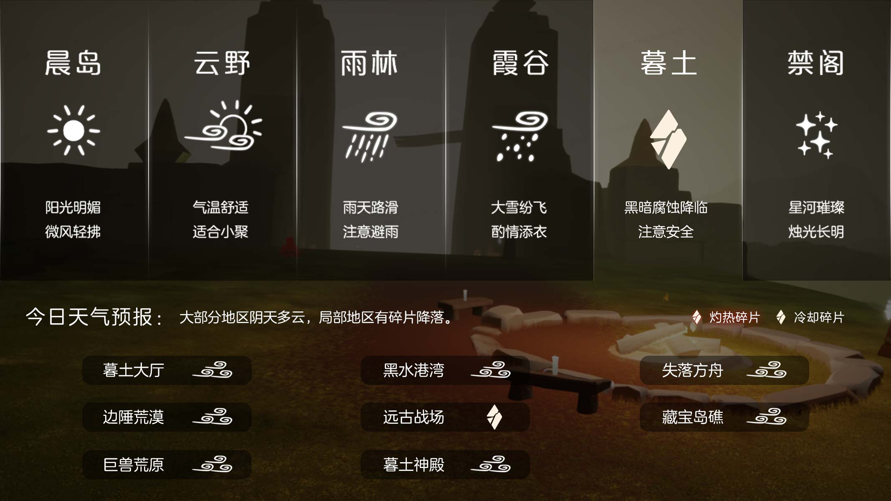
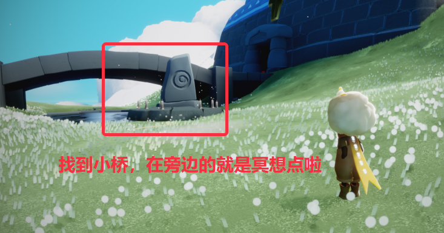

# 🌤 光遇每日任务

[](https://github.com/oivio-up/SkyDailyInfo/actions/workflows/update-daily.yml)

自动获取并展示《光·遇》每日任务和活动信息。

**[打开每日旅行手册 →](https://oivio-up.github.io/SkyDailyInfo/)** · 支持手机浏览、任务勾选、天气与图片攻略。

## 💡 项目说明

本项目通过 **Cloudflare Worker** 中转 API 请求，使用 **GitHub Actions** 每日自动更新，将光遇的每日任务和活动信息展示在 README 中。

### 特性

- ✨ 每日自动更新任务和活动信息
- 🔒 敏感数据（UID、Token）安全存储在 Cloudflare
- 🚀 通过 Cloudflare Worker 中转 API，保护隐私
- 📱 清晰的任务和活动展示
- 🖼️ 图片保存到仓库，避免外链代理失效
- ⏰ 北京时间每天 8:00 自动更新

---

<!-- DAILY_TASK_START -->
## 📅 2026年10月21日 每日任务

> 最后更新: 2026年10月21日 11:21:58 (北京时间)

### 🎯 今日旅行指南

```
【今日旅行指南】
1. 在云野的锦鲤池旁冥想
2. 在荧光小菇旁回复能量
3. 向一位朋友做个动作
4. 帮助苦修行者
```

### 🌤️ 天气预报

天气播报：今日将会有冷却碎片坠落在远古战场




### 📅 本月日历


### 📖 任务详细攻略


#### 📍 每日任务－在云野的锦鲤池旁冥想

【每日任务－在云野的锦鲤池旁冥想】
任务：在云野的锦鲤池旁冥想
位置：云野－三塔图－锦鲤池
步骤：进入云野三塔图后往终点方向飞，找到小桥，在小桥旁即可找到
视频指引
https://ok.166.net/gameyw-gbox/bot/205/20261020/11d9992f5b77ceb4e566d5c8129f96e0c561d019.mp4
 今日推荐：《想你时风起》琴谱分享https://ds.163.com/feed/69ca579a348f8f5d0b7821ca/?utm_content=f_ma75.jl.jlctPT.top.8gq3ek&utm_term=wyds_dl_jl_sky3_5cb546a0d5456870b97d9424&utm_bothash=ma75_bot_367bc25a42d1935a6e04c90df3bd91be&q=每日任务－在云野的锦鲤池旁冥想




---


#### 📍 荧光小菇

【荧光小菇】
小贴士：旅人们跳到荧光小菇上可补充能量
(能量几乎消耗完时再跳上去会更容易完成每日任务哦)
地点：荧光小菇是生长在雨林的植物。
特性：荧光小菇呈半透明状态并且会发光，旅人们站在荧光蘑菇上可以悬浮起来，极容易辨认。
 今日推荐： 光崽干饭图鉴！九种类型你属于哪种？https://ds.163.com/feed/69e6189fd0179a4476925567/?utm_term=wyds_dl_jl_sky3_5cb546a0d5456870b97d9424&utm_content=f_ma75.jl.jlctPT.default.pzzzyt&utm_bothash=ma75_bot_367bc25a42d1935a6e04c90df3bd91be&q=荧光小菇


---


#### 📍 苦修行者任务

【每日任务－帮助苦修行者】
请旅人先查看接到的任务名称，然后在下方选择对应指南
在云峰找到苦修行者　｜　苦修行者在云巢需要帮助
小精灵提示：
1、若旅人从未收集过该先祖，任务会显示为：在云峰找到苦修行者；
2、若旅人之前已收集过该先祖，任务会显示为：苦修行者在仙乡需要帮助。
 今日推荐： 光崽干饭图鉴！九种类型你属于哪种？https://ds.163.com/feed/69e6189fd0179a4476925567/?utm_term=wyds_dl_jl_sky3_5cb546a0d5456870b97d9424&utm_content=f_ma75.jl.jlctPT.default.pzzzyt&utm_bothash=ma75_bot_367bc25a42d1935a6e04c90df3bd91be&q=苦修行者任务


---


### 🎪 今日活动

今日暂无特殊活动

---

<!-- DAILY_TASK_END -->
